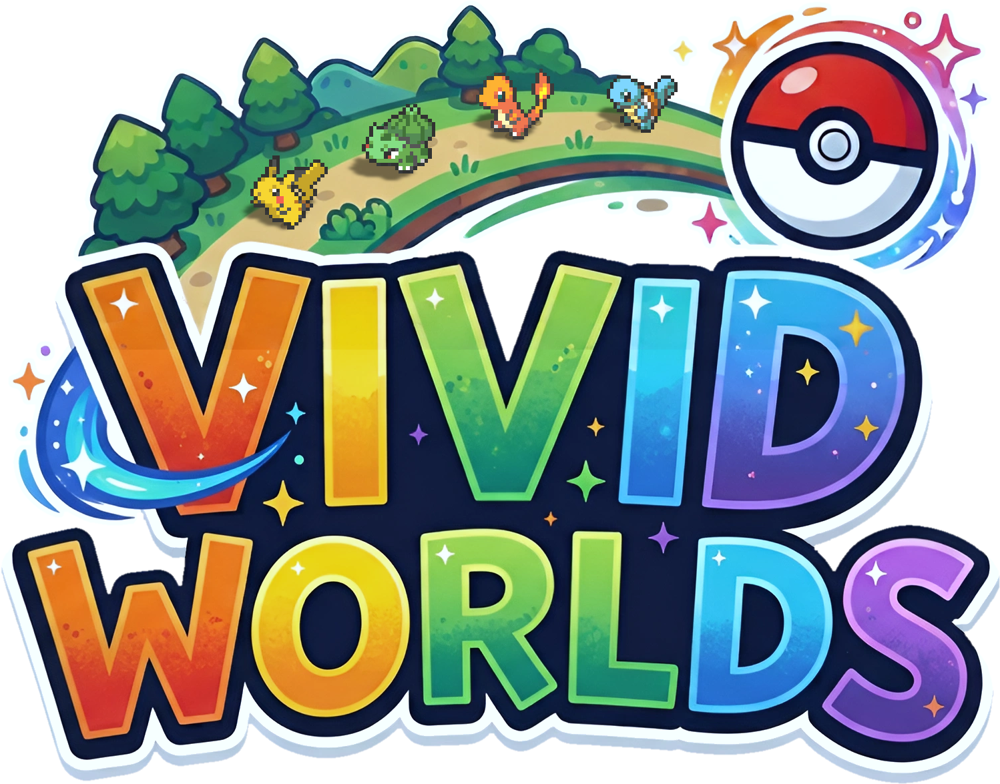
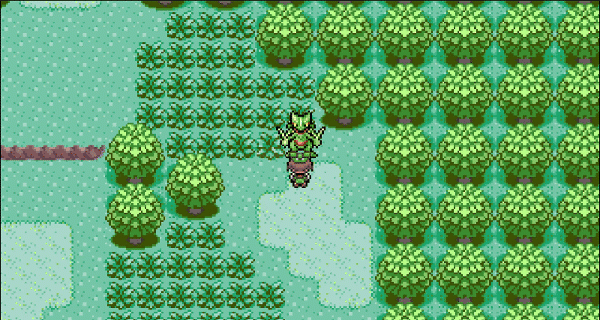
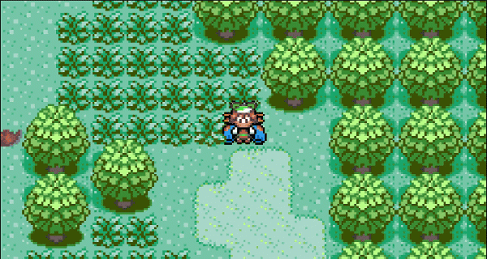
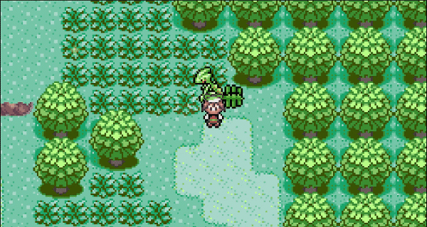

# Vivid Worlds 🌿

*Formerly Wilds of Hoenn.*

*The tall grass is alive. Wild Pokémon roam the overworld of Ruby, Sapphire, Emerald, FireRed
and LeafGreen. Walk up to one to battle it, and bring a partner along for the journey.*

A mod for [Gen1Recomp](https://github.com/bryanthaboi/gen1recomp)'s Generation 3 games.

<table>
<tr>
<td align="center" width="33%"></td>
<td align="center" width="33%"></td>
<td align="center" width="33%"></td>
</tr>
<tr>
<td align="center"><b>Play</b> Pet, play fetch or chat with your partner.</td>
<td align="center"><b>Battle</b> Your partner fights nearby wild Pokémon for EXP.</td>
<td align="center"><b>Forage</b> Your partner digs up items as you walk.</td>
</tr>
</table>

## ✨ Features

### Core Mechanics

- 🦌 **Visible wild Pokémon:** grass, water and caves fill with wild Pokémon taken from the
  game's own encounter tables. Walk onto one to battle it. The Safari Zone works too.
- 🎲 **Classic encounters optional:** keep the random step encounters alongside, or only meet
  what you can see.
- 💕 **Sweet Scent** draws a few wild Pokémon to you, and they wait to be battled.
- ✨ **Shiny chains** (with [WoobleSpawns](https://github.com/poooooby/g1r_modern_spawns)):
  keep battling one species and it shows up more often, with better shiny odds and stats.

### Your Partner

- 🫂 **Follower:** your lead Pokémon walks behind you. Face it and press A to **Pet**, **Play**
  or **Talk**, which raises friendship. Its portrait and mood reflect its health and your bond.
- ⚔️ **Battler:** stand still and it fights wild Pokémon around you with its real moves, earning
  EXP (Exp. Share works). It never faints, and new moves and evolutions are offered after a fight.
- 🍂 **Forager:** on routes and in caves it digs up items as you walk. Friendlier partners find
  more and rarer items.
- 🚲 It rides along in its Poké Ball on a bike, when you Fly, and during cutscenes.

### A Living World

- 🏃 **Pokecology:** wild Pokémon behave like their species. Skittish ones flee, territorial ones
  chase you, and packs, herds and schools move together. Some sleep by night or by day, diggers
  burrow, hunters chase prey, and some glow after dark.
- 🌊 **Water life:** swimmers dive and resurface, fish leap, Wailmer spout, and Finizen porpoise
  out at sea.
- 🕊️ **Birds in the sky:** birds fly overhead, perch on roofs and dive for fish.
- 👻 **Local scenes:** a few special places have their own moments, in Lavender Town, Petalburg
  Woods and Fortree City.
- 🎨 **Two sprite styles:** HGSS / PokeMMO art or animated PMDCollab sprites, with alternate and
  regional forms.
- 📏 **True-to-life sizes** (with [WoobleView](https://github.com/poooooby/gen3-hd-sprites)).

## ⚙️ Options

Change these in the Mod Manager, or in game from **OPTIONS → VIVID WORLDS**.

| Option | Choices | Default | What it does |
|---|---|---|---|
| **Language** | EN / JA / PT / ES / DE | ENGLISH | Language of the mod's own text. |
| **Show Wild Mons** | ON / OFF | ON | Visible wild Pokémon. |
| **Spawn Amount** | LOW / NORMAL / HIGH | NORMAL | How many are out at once. |
| **Flying Mons** | FULL / AMBIENT / OFF | FULL | Birds in the sky. Ambient leaves out the high flyers. |
| **Water Life** | ON / OFF | ON | Leaping fish, spouting whales, Finizen and fish under the sea. |
| **Local Scenes** | ON / OFF | ON | Scenes in a few special places. |
| **Pokecology** | ON / OFF | ON | Species behaviour and reactions to you. Off: they just wander. |
| **Sprite Style** | HGSS / PMD | PMD | Art for wild Pokémon and your partner. |
| **Follower** | ON / OFF | ON | Off keeps your partner in its Poké Ball. |
| **Battler: Pad** | R / L / OFF | OFF | Controller button that switches your partner between Battle and Follow. |
| **Battler: Key** | E / Q / R / OFF | OFF | The same on the keyboard. |
| **Smooth Follow** | ON / OFF | ON | Your partner glides round turns instead of snapping. |
| **Type Aura** | ON / OFF | OFF | Your partner gives off puffs of its type now and then. |
| **Classic Enc** | ON / OFF | ON | Random step encounters in grass and while surfing. |
| **Silhouette** | OFF / UNDISCOVERED / ALL | OFF | Draws uncaught (or all) wild Pokémon as silhouettes. |
| **Species Sizes** | ON / OFF | ON | Each species at its real relative size. Needs WoobleView. |
| **Portraits** | ON / OFF | ON | Your partner's portrait in its messages. |

## 💾 Installation

1. Download the latest ZIP from [Releases](https://github.com/poooooby/wilds-of-hoenn/releases)
   (about 40 MB, both sprite styles).
2. Import it with the Gen1Recomp Mod Manager, or drop it in your mods folder.
3. Enable **Vivid Worlds**.

## 🔗 Works With

- [WoobleDex](https://github.com/poooooby/national_dex_gen3): wild Pokémon up to #1025.
- [WoobleSpritePack](https://github.com/poooooby/g9-battle-sprites-gen3): battle sprites for the new species.
- [WoobleSpawns](https://github.com/poooooby/g1r_modern_spawns): modern encounter tables and shiny chains.
- [WoobleView](https://github.com/poooooby/gen3-hd-sprites): smooth, true-to-size sprites.

## 📌 Good to Know

- **Choosing your partner:** your party's lead is your partner. To change it, pick a Pokémon in
  the party menu and choose **FOLLOW**, **BATTLE** or **FORAGE**. Your pick stays until you
  change your lead.
- **Battler button:** set one in the options to send your partner in or call it back without a
  menu. In FireRed / LeafGreen, that button no longer opens Help in the overworld.
- **Wild Pokémon only spawn where you can walk.** Water Pokémon fill every lake and sea.
- **Group battles:** walking into a group battles its leader.
- **Pokémon your partner has been fighting** keep the HP it left them with when you battle them.
- **Day and night:** the game's clock decides, or your computer's clock in FireRed and
  LeafGreen.
- **Japanese** is written in kana, and Portuguese shows ã / õ as a / o, because of the game's font.

## 🪪 Credits

- **HGSS / PokeMMO overworld sprites:** many artists, collected by
  [Wilds of Kanto Revival](https://github.com/poooooby/wilds-of-kanto-gen-3)
  ([full credits](THIRD_PARTY_NOTICES.md)).
- **PMDCollab sprites and portraits:** [PMDCollab/SpriteCollab](https://github.com/PMDCollab/SpriteCollab),
  **CC BY-NC 4.0** (non-commercial). Per-species artists are in `assets/pmd/CREDITS.txt`.
- **Zygarde 100% overworld sprite:** [pokeemerald-expansion](https://github.com/rh-hideout/pokeemerald-expansion)
  (Liamjd14, kittenchilly).
- **The community:** many features began as player suggestions on Discord. See
  [COMMUNITY.md](COMMUNITY.md). Thank you! 💚

## 💡 Inspirations

- **TTiN** and **Untamed Tohjo**: friendship-weighted foraging and shiny chains (used with
  permission).
- **Wilds of Kanto Revival**: the sister project for Generations 1 and 2.

## 🤖 AI Disclosure

Developed with help from [Claude Code](https://claude.com/claude-code) (Anthropic), working from
the maintainer's direction, design and in-game testing. The maintainer approves every release.
Found a bug? Open an issue here or on Discord.

---

The mod's code is [MIT](LICENSE); the art is not (see [THIRD_PARTY_NOTICES.md](THIRD_PARTY_NOTICES.md)).
Pokémon is © Nintendo, Game Freak and The Pokémon Company; this is an unofficial fan project.
Working on the mod? See [DEVELOPMENT.md](DEVELOPMENT.md).
