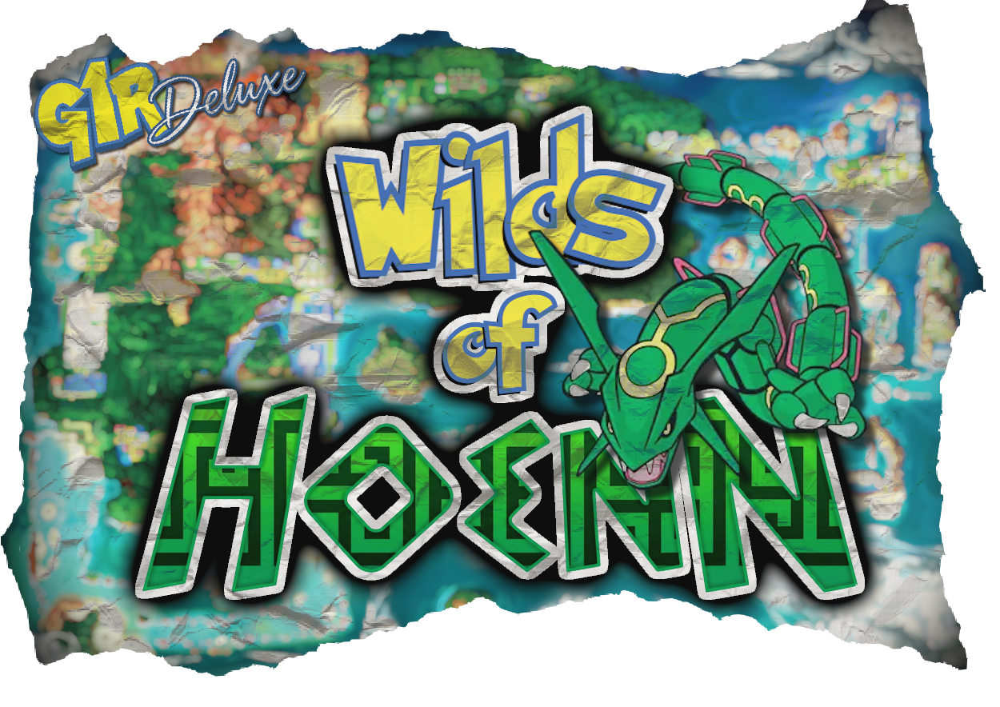

# Wilds of Hoenn 🌿

*The tall grass is alive. Wild Pokémon roam the overworld of Ruby, Sapphire, Emerald, FireRed
and LeafGreen. Walk up to one to battle it, and bring a partner along for the journey.*

A mod for [Gen1Recomp](https://github.com/bryanthaboi/gen1recomp)'s Generation 3 games.

## ✨ Features

### Core Mechanics

- 🦌 **Wild Pokémon in the overworld:** Every area with wild encounters fills with visible
  Pokémon wandering the grass, swimming the water and roaming caves. Walk onto one to start the
  battle. They come straight from the game's own encounter tables, abilities, outbreaks and
  roamers included. On land they only appear where you can actually walk to, while water
  Pokémon fill every lake and sea, Surf or not.
- 🤝 **A partner with a job:** Choose any Pokémon in your party menu and give it a role. It can
  **follow** you, **forage** for items as you walk, or **battle** the wild Pokémon around you,
  Scarlet and Violet style.
- 🎲 **Classic encounters, your call:** Keep the original step-based grass and Surf encounters
  alongside the visible ones, or turn them off and only meet what you can see.
- ✨ **Shiny chains** (with [Modern Spawns](https://github.com/poooooby/g1r_modern_spawns)): win
  or catch the same species again and again and it turns up more, is likelier to be shiny and
  has better stats. Shinies always show their colours on the overworld.

### Your Companion

- 🫂 **Friendship you can see:** Face your partner and press A to **Pet**, **Play** fetch or
  **Talk**. Each one raises its friendship, and its portrait shows how it really feels from
  its HP, status and bond with you. Petting can even cure a status.
- ⚔️ **Battler:** Stand still near a wild Pokémon and your partner charges in. It fights with
  its real moves, stats and PP, on land or swimming out over water, and earns EXP. Health bars
  and hit effects show on both sides. When it levels up, it tells you a new move or evolution
  is ready, and you can open the game's own screens from its menu. It never faints: worn out,
  it returns to you to rest.
- 🍂 **Forager:** On routes and in caves, every 1-3 minutes of walking it catches a scent,
  dashes to a glint on the ground and always digs something up. The fonder it is, the sooner it
  finds things, and the rarer they get: evolution stones from friendship 130, the rarest finds
  from 200.

### A Living World

- 🎨 **Two sprite styles:** **HGSS / PokeMMO** art for the whole National Dex, or fully
  animated **PMDCollab** sprites with walk, idle, attack and hurt animations.
- 🌊 **Water that feels like water:** Pokémon swim with a foam line on the water, leave ripples
  on ponds and puddles, and cast reflections like the player and NPCs do.
- 🌾 **Small touches:** Pokémon sink into tall grass, your partner fades in as you step out of a
  door, and alternate forms (Rotom, Shellos, Basculin and many more) have their own art.
- 📏 **True-to-life sizes** (with [Gen 3 HD Sprites](https://github.com/poooooby/gen3-hd-sprites)):
  every species is drawn at its own relative size, smoothly, at your screen's resolution.

## ⚙️ Options

### Mod options (Mod Manager)

| Option | Choices | Default | What it does |
|---|---|---|---|
| **Show Wild Mons** | On / Off | On | Visible wild Pokémon in areas with wild encounters. |
| **Sprite Style** | HGSS / PokeMMO, PMDCollab | PMDCollab | The look of wild Pokémon and your partner. Species without PMDCollab art use HGSS / PokeMMO. (PMDCollab is in the HGSS + PMDCollab build only.) |
| **Classic Enc** | On / Off | On | The original step-based grass and Surf encounters. Visible Pokémon stay either way; fishing and Rock Smash are unaffected. |
| **Silhouette** | Off / Undiscovered / All | Off | Draws wild Pokémon as silhouettes: species you haven't caught, or all of them. |
| **Species Sizes** | On / Off | On | Draws each species at its own relative size. Needs Gen 3 HD Sprites. |

Shiny chains are switched on and off with Modern Spawns' **SHINY CHAINS** option.

### Your partner (party menu)

Select a Pokémon in the party menu and choose its job. The party leader follows until you pick
someone else, and one partner is out at a time.

| Row | What it does |
|---|---|
| **FOLLOW** | Walks with you. Press A facing it for Pet, Play or Talk. |
| **BATTLE** | Fights wild Pokémon within 3 tiles of you while you stand still. |
| **FORAGE** | Digs up items while you walk on routes and in caves. |

## 💾 Installation

1. Download a release from the [Releases](https://github.com/poooooby/wilds-of-hoenn/releases)
   page. Pick **one**:
   - **HGSS + PMDCollab**: the full experience, with animated PMDCollab sprites and portraits
     (about 30 MB).
   - **HGSS Only**: a much smaller download for lower-power devices (Anbernic, older Android).
2. Import it with the Gen1Recomp Mod Manager, or drop it in your mods folder.
3. Enable **Wilds of Hoenn**.

## 🔗 Works With

- [National Dex Gen 3](https://github.com/poooooby/national_dex_gen3): wild Pokémon all the way
  to #1025, with overworld art for every one.
- [G9 Battle Sprites (Gen 3)](https://github.com/poooooby/g9-battle-sprites-gen3): battle sprites
  for the new species.
- [Modern Spawns](https://github.com/poooooby/g1r_modern_spawns): modern encounter tables and
  shiny chains.
- [Gen 3 HD Sprites](https://github.com/poooooby/gen3-hd-sprites): smooth, true-to-size sprites.

## 🪪 Credits

- **HGSS / PokeMMO overworld sprites:** many artists, collected by
  [Wilds of Kanto Revival](https://github.com/poooooby/wilds-of-kanto-gen-3)
  ([full credits](THIRD_PARTY_NOTICES.md)).
- **PMDCollab sprites and portraits:** [PMDCollab/SpriteCollab](https://github.com/PMDCollab/SpriteCollab),
  licensed **CC BY-NC 4.0** (non-commercial). Per-species artists ship in the HGSS + PMDCollab
  build as `assets/pmd/CREDITS.txt`.
- **Zygarde 100% overworld sprite:** [pokeemerald-expansion](https://github.com/rh-hideout/pokeemerald-expansion)
  (Liamjd14, kittenchilly).

## 💡 Inspirations

- **TTiN** and **Untamed Tohjo**: friendship-weighted foraging and shiny chains (used with
  permission).
- **Wilds of Kanto Revival**: this mod's sister project, for Generation 1 and 2.

## 🤖 AI Disclosure

This mod was developed with help from [Claude Code](https://claude.com/claude-code) (Anthropic),
working from the maintainer's direction, design decisions, in-game testing and bug reports. The
maintainer approves every release. If you find a bug, please open an issue here or on Discord.

---

The mod's code is [MIT](LICENSE); the art is not (see [THIRD_PARTY_NOTICES.md](THIRD_PARTY_NOTICES.md)
for every credit and licence). Pokémon is © Nintendo, Game Freak and The Pokémon Company; this is
an unofficial fan project. Working on the mod? See [DEVELOPMENT.md](DEVELOPMENT.md).
